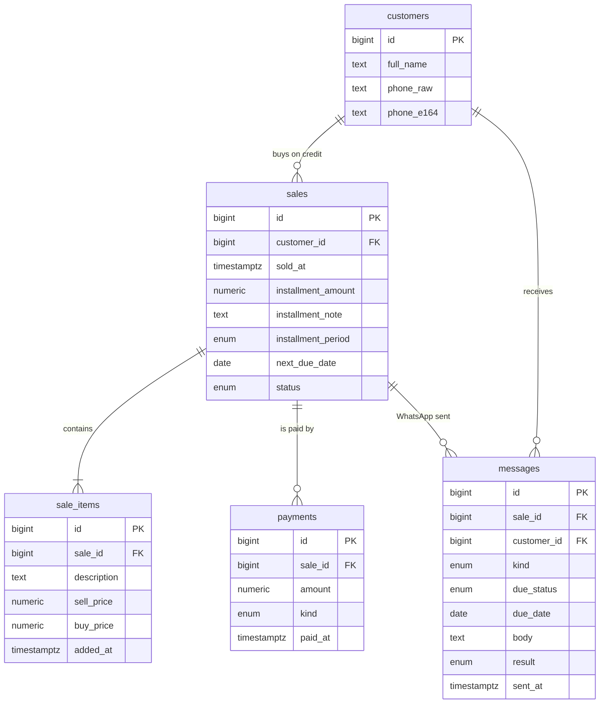

# Database schema (PostgreSQL)

`schema.sql` is a database version of the 17-column Google Sheet managed by
`code.gs`. Load it with:

```bash
createdb electro
psql -d electro -f db/schema.sql
```

It needs PostgreSQL 13 or newer. It also works on hosted PostgreSQL such as
Supabase or Neon: paste the file in their SQL editor.

## Tables



Also: `settings` (shop name, phone, delay) and `audit_log` (history of every change).

## Where each sheet column went

| Sheet column | In the database |
|---|---|
| A اسم الزبون | `customers.full_name` |
| B الهاتف | `customers.phone_raw` (as typed) + `customers.phone_e164` (`212…`) |
| C السلع + time stamps | one `sale_items` row per item: `description`, `added_at` |
| D ثمن البيع `3000+500` | `sale_items.sell_price`, one per item |
| E ثمن الشراء | `sale_items.buy_price`, one per item |
| F الربح | **computed** in the `sale_totals` view (`profit`) |
| G التسبيق `500 (stamp) + 300 (stamp)` | one `payments` row per amount: `amount`, `paid_at`; the first is `kind = 'advance'` |
| H المتبقي | **computed** in `sale_totals` (`remaining`) |
| I المدة (سيمانة / 15 يوم / شهر / تحديد يدوي) | `sales.installment_period` = `week` / `15_days` / `month` / `manual` |
| J تاريخ الدفعة | `sales.next_due_date` |
| K, L, M | not used by `code.gs`, so not in the schema |
| N الطريطة | `sales.installment_amount`, or `sales.installment_note` when it isn't a number |
| O / P WhatsApp links | built when sending; every send is saved in `messages` |
| Q print invoice | nothing to store: the invoice is generated from the tables |
| hidden `_Backup_Security_` sheet + secret code `1982` | `audit_log` (automatic triggers) + database user permissions |
| `الزبناء المتأخرين` sheet | the `due_reminders()` function |
| Script Properties `WA_API_URL` / `WA_API_TOKEN` | not in the database: keep secrets in environment variables |

## What changes compared to the sheet

- **One customer, many sales.** In the sheet a customer who buys again gets
  `+ item` added to the same row. Here each purchase is its own `sales` row, with
  its own due date and instalment.
- **Profit and remaining can't be wrong or stale.** They are always calculated
  from items and payments, and amounts are real numbers: `1 500` can no longer be
  read as 501.
- **Payments can't be negative or zero**, phone numbers must be 11–15 digits, and
  a customer with sales can't be deleted by mistake.
- **Every change is kept.** Editing or deleting a customer, sale, item or payment
  saves the old values in `audit_log` with who changed it and when.
- **"+1 month" from 31 January gives 28 February**, not 3 March like the sheet.

## Useful queries

```sql
-- Who must be reminded today (same rules as the sheet: late, today, tomorrow)
SELECT * FROM due_reminders();

-- ...only those not already reminded today
SELECT * FROM due_reminders()
WHERE last_reminded_at IS NULL OR last_reminded_at::date < shop_today();

-- Profit report (showProfitReportDialog)
SELECT c.full_name, t.sell_total, t.buy_total, t.profit, t.paid_total, t.remaining
FROM sale_totals t JOIN customers c ON c.id = t.customer_id
WHERE t.status = 'active';

-- Total money customers still owe
SELECT sum(remaining) FROM sale_totals WHERE status = 'active' AND remaining > 0;

-- Record a payment and move the next due date forward one period
INSERT INTO payments (sale_id, amount) VALUES (1, 500);
UPDATE sales
SET next_due_date = next_date_for_period(installment_period, next_due_date)
WHERE id = 1 AND installment_period <> 'manual';

-- Save a WhatsApp reminder that was sent
INSERT INTO messages (sale_id, customer_id, kind, due_status, due_date, phone_e164, body, result)
VALUES (1, 1, 'reminder', 'overdue', '2026-10-20', '212661234567', '…message…', 'sent');
```
